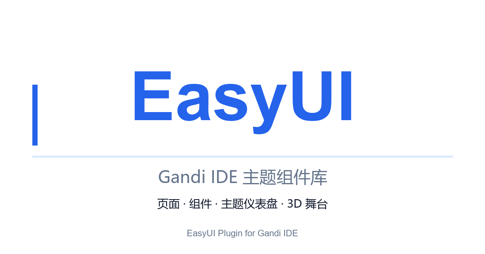

# EasyUI

> Gandi IDE / CCW 的舞台 UI 组件库：页面、群组、拖拽、40+ 组件、主题仪表盘与 3D 组件。



## 功能

- **页面与群组**：多页面切换、群组整体拖拽、惯性拖拽、网格吸附。
- **40+ 舞台组件**：按钮、卡片、输入框、选项卡、折叠面板、表格、弹窗、Toast、评分、进度条等，全部带键盘与 ARIA 支持。
- **主题平台**：基于 M3E 设计令牌自动生成控件，实时预览；支持背景图 imageMap、补充 CSS 净化、主题校验、集市发布/下载与本地持久化。
- **3D 舞台**：Three.js 共享渲染层、3D 圆角方块、点击/悬停交互、可开关的 Cannon-es 物理模拟。
- **集市**：通过 CCWData 读写 `easyui_theme_<id>` 与 `easyui_theme_index`；不可用时自动降级为本地主题并支持 JSON 导入导出。

## 启用

1. 在 Gandi IDE 插件面板中启用 **EasyUI**。
2. 积木面板末尾会出现【主题与仪表盘】与【3D 组件】分类。
3. 点击“打开主题仪表盘”按钮即可进入主题编辑器。

插件启用时会把内置的 EasyUI 运行时注册为非沙箱 Scratch 扩展；关闭插件只关闭仪表盘，不会移除作品里已使用的积木。

## 支持的编辑器版本

- Gandi IDE / CCW 线上编辑器（2026-11 验证）
- 需要 `window.Scratch.extensions.register`（非沙箱扩展 API）
- 浏览器：Chrome / Edge 100+（WebGL2；3D 依赖 WebGL）

## 使用场景

- 用可视化组件搭建游戏菜单、关卡选择、排行榜与设置面板。
- 用主题仪表盘统一作品配色、圆角、字体与动效，发布到集市复用。
- 用 3D 方块做按钮、徽章或可碰撞的舞台道具。

## 目录

```
src/plugins/easyui/
├── manifest.ts              # 插件清单
├── index.ts                 # 插件入口：注册 EasyUI 运行时
├── easyui-runtime.asset     # 打包后的 EasyUI v3 单文件运行时
├── cover.png                # 1200×630 封面
├── icon.png                 # 512×512 图标
└── README.md
```

## 开发与测试

EasyUI 源码独立维护，使用 esbuild 打包为单文件后复制到 `easyui-runtime.asset`：

```bash
pnpm build        # dist/easyui.js + dist/easyui-dashboard.html
pnpm test         # 130 项单元/集成测试
```

运行时行为验证：

- v2.4.2 原有 90+ 积木的 opcode / 文本 / 默认值 / 菜单对齐测试。
- 主题 Schema、CSS 净化与作用域、img.scdn.io 上传（错误码 / 429 重试）、CCWData 分片与降级。
- 真实 Chromium：WebGL 单上下文、物理下落、Shadow DOM 仪表盘、模拟 CCW CSP。

## 已知限制

- CCW 页面 CSP 的 `connect-src` / `img-src` 当前未放行 `img.scdn.io`，内联仪表盘中的图床上传/图片加载可能被浏览器拦截；独立打开 `dist/easyui-dashboard.html` 不受影响，也可手动填写图片 URL。
- 主题集市依赖 `window.CCWData`；不可用时自动降级为本地主题。

## 许可证

本插件遵循仓库根目录的 LGPL-3.0-only 许可证。EasyUI 运行时使用的 three.js、cannon-es 均为 MIT。
